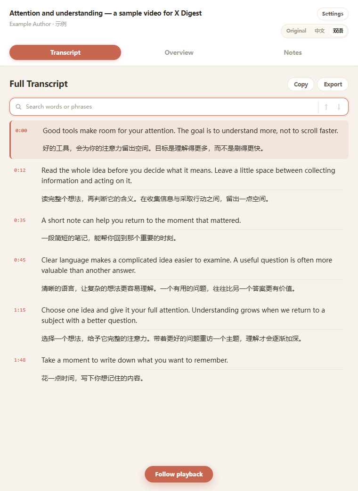
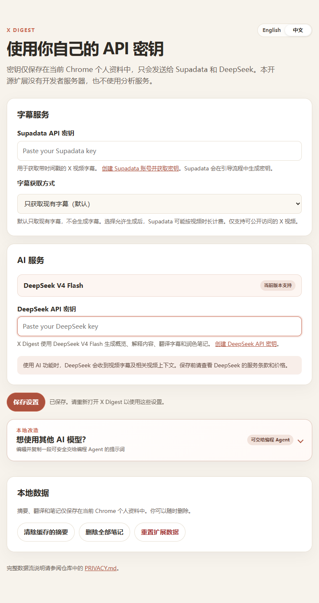

# X Digest · X 视频学习侧栏

在 Chrome 右侧查看 X 视频字幕，切换原文、中文或双语，随播放定位，并生成概览、解释选文、保存带时间戳的笔记。

[下载扩展 ZIP](https://github.com/jin345764-boop/x-digest/releases/latest) · [反馈问题](https://github.com/jin345764-boop/x-digest/issues) · [隐私说明](PRIVACY.md) · [MIT 许可证](LICENSE)

X Digest 0.2.0 基于 [Zara Zhang 的 YouTube Digest](https://github.com/zarazhangrui/youtube-digest) 改编，保留原项目的布局、字幕处理、AI 功能和本地笔记流程，将播放器和字幕入口适配为 X 视频。非原作者发布的官方 X 版本。

参考源码：`bb2f7b1aedb6b50c261c0cf35b0acc7ed631d833`。原项目 MIT 许可证及版权声明保留在 LICENSE。

## 界面预览

以下截图使用模拟视频与模拟服务响应展示界面，不代表已测试所有真实 X 视频。



<details>
<summary>查看中文设置页</summary>



</details>

## 安装到 Chrome

需要桌面版 Google Chrome 116 或更高版本。无需 Node.js、无需编译；当前通过本仓库安装，未上架 Chrome 网上应用店。

1. 在 [Releases](https://github.com/jin345764-boop/x-digest/releases/latest) 下载 **X-Digest.zip**，解压到一个固定文件夹。Windows 可放到 `D:\Apps\x-digest`，避免占用 C 盘；安装后不要移动或删除该文件夹。
2. 在 Chrome 地址栏输入 `chrome://extensions` 并打开。
3. 开启右上角 **开发者模式**。
4. 点击 **加载已解压的扩展程序**，选择解压后包含 `manifest.json` 的文件夹。不要直接选择 ZIP，也不要选择外面多包的一层目录。
5. 在 Chrome 工具栏的扩展菜单中固定 **X Digest**，方便打开侧栏。

也可从 GitHub 的 **Code → Download ZIP** 下载源码，解压后加载包含 `manifest.json` 的目录。会使用 Git 的用户可运行：

```sh
git clone https://github.com/jin345764-boop/x-digest.git
```

## 第一次使用

1. 点击工具栏 X Digest，打开 **Settings → 中文**。
2. 分别填写 **Supadata API 密钥**与 **DeepSeek API 密钥**，点击 **保存设置**。两项都需要，获取方式见下文。
3. 打开一条公开的、包含单个视频的 **X 推文详情页**，网址形如 `https://x.com/用户名/status/推文编号`。在作者主页或首页看到视频时，点击这条推文的 **发布时间** 进入详情；停留在主页直接播放视频不能加载字幕。
4. 先点击播放，让播放器加载，再点击工具栏 X Digest，或视频上的 **Digest** 按钮。
5. 在 **Transcript** 选择 **Original / 中文 / 双语**。点击字幕时间戳可跳转视频；播放时侧栏会跟随当前段落。手动滚动后，点击 **Follow playback** 恢复跟随。
6. 打开 **Overview** 按需生成章节和关键引文，点击章节或引文可跳转视频。
7. 在字幕中选择文本，可点击 **Explain** 解释或 **Note** 保存。视频上的 **Note** 按钮可保存播放位置附近的笔记。在 **Notes** 中回看、播放、复制或删除。

支持字幕搜索、复制、导出；搜索结果跳转只定位字幕，不改变视频进度。字幕按语义组合并逐段翻译，因此不会逐个词同步。先取视频完整字幕，再按需要翻译；不是无字幕直播的实时同传。

## 两个服务与设置

- **Supadata**：获取带时间戳的视频字幕。自行在 [控制台](https://dash.supadata.ai/) 注册并生成密钥。
- **DeepSeek**：翻译、概览、解释与自动笔记润色。自行在 [API 密钥页面](https://platform.deepseek.com/api_keys) 创建密钥。
- 与参考项目保持一致，AI 地址固定为 `https://api.deepseek.com`，模型为 `deepseek-v4-flash`。更换供应商需要修改本地代码；设置页保留了原项目的修改提示词。
- 密钥只填写在扩展 Settings 的密码框里，不需要发到聊天中。密钥保存在当前浏览器个人资料的本地扩展存储内，不会从其他扩展自动读取。
- 设置页的中英文切换作用于设置界面；侧栏的 Original / 中文 / 双语控制学习内容的显示方式，沿用参考项目设计。

两个服务需要分别注册账号。创建密钥后，分别粘贴到同名设置框，再保存设置并重新打开侧栏；原版 YouTube Digest 或其他扩展中的密钥不会自动共享。如果服务提示额度不足，请在对应提供商的控制台检查余额及用量。本扩展不出售密钥或内置公共额度。

### X 视频的字幕方式

默认 **只获取现有字幕（native）**，与原项目的选择一致。当服务返回没有现有字幕时，不会自动生成，也不会自动改用其他服务。

X 视频缺少现有字幕时，可在 Settings 将“字幕获取方式”改为 **没有字幕时允许生成（auto）**。Supadata 将尝试现有字幕，必要时转写视频；生成字幕可能耗时并按视频时长计费。两种方式的额度和费用以 [Supadata 官方说明](https://docs.supadata.ai/get-transcript)及账号显示为准。DeepSeek 另行计费。

打开新视频时先显示原文；切换中文或双语才会请求对应字幕段落的翻译；打开 Overview 才会请求概览。重复打开命中本地缓存时可复用结果。异步转写会保存任务编号，重开侧栏继续查询该任务；请求超时且未取得任务编号时，先检查服务控制台再决定是否重试。

## 与 YouTube Digest 的对应关系

| 原项目 | X 视频版 |
| --- | --- |
| Transcript / Overview / Notes 三页签 | 保留 |
| 原文、中文、双语和逐段翻译 | 保留 |
| 字幕搜索、复制、导出、播放跟随 | 保留并接入 X 播放器 |
| AI 概览、选文解释、带时间戳笔记 | 保留并使用 X 视频链接 |
| Supadata + DeepSeek 自带密钥 | 保留 |
| YouTube 字幕与播放器接口 | 改为 Supadata 的 X URL 接口及当前推文的 HTML 视频播放器 |
| 固定只获取原生字幕 | 默认相同；增加明确选择的 auto 转写方式 |

## 范围与排查

| 看到的情况 | 处理方法 |
| --- | --- |
| Ready to Digest，侧栏一直是欢迎页 | 进入单条视频推文详情；点击推文发布时间，确认网址含 `/status/数字`，播放后重新打开侧栏。 |
| No transcript found | 打开 Settings → 中文，将“字幕获取方式”由“只获取现有字幕”改为“没有字幕时允许生成”，保存后关闭并重新打开侧栏，等待转写。该选项可能按视频时长计费。 |
| 已填密钥但仍提示缺少密钥 | 确认两项都已填写，点击“保存设置”，再重新打开侧栏；不要只填写其中一个服务的密钥。 |
| 找不到播放器，或升级后按钮不出现 | 在扩展管理页重新加载 X Digest，再刷新 X 推文页面并先播放视频。 |
| HTTP 401 / 402 / 429 | 分别检查对应服务的密钥、账号额度，或稍后重试。 |
| 转写长时间等待或失败 | 确认视频可公开访问且含语音；异步任务重开后会继续查询。若超时且没有任务编号，先检查 Supadata 控制台，避免反复提交。 |

- 当前支持可以公开访问、含单个视频的推文详情页，以及该视频的 `/video/1` 页面。首页信息流、多个视频的推文、登录或权限受限内容、直播未支持。
- X 页面结构或第三方服务支持范围变化，可能需要更新扩展。能够在登录后的 X 播放，不代表字幕服务也能访问该视频。
- 提示找不到播放器：刷新 X 页面，进入视频推文详情，先点击播放，再重新打开侧栏。
- 提示没有现有字幕：确认是否愿意使用按时长计费的生成方式，然后在设置中选择 auto。
- 401：检查对应密钥；402：检查对应账号额度；429：稍后重试。不要把密钥或完整错误请求截图发到聊天。
- 升级后在扩展管理页点击重新加载，按浏览器提示确认新增的 Supadata 访问权限，再刷新原 X 页面。
- 笔记保存在本地，最多 100 条；缓存最多 20 个视频，超过 30 天的缓存会在打开侧栏时清理。清理缓存不会删除笔记；重置全部数据会删除密钥、笔记和缓存。

### 更新已安装的扩展

下载新版并解压，将原安装目录的文件更新为新版；然后在 `chrome://extensions` 找到 X Digest，点击 **重新加载**。确认浏览器提示的权限，再刷新原 X 页面。保留原安装位置和扩展条目，通常可以保留本地设置与笔记；卸载扩展会清除其本地数据。

## 开发与验证

原生 HTML/CSS/JavaScript，Chrome Manifest V3，无运行时依赖，也无需构建。开发验证建议使用 Node.js 24；项目没有依赖包，无需 `npm install`：

```sh
npm test
npm run check
```

Windows 下运行 `npm run package` 生成上一级目录的 `X-Digest.zip`；安装扩展本身不需要运行这些命令。

交付前通过 55 项单元测试和隔离浏览器中的完整扩展测试，覆盖真实视频元素定位、播放跟随、双语翻译、章节、解释、笔记、设置和缓存。测试使用模拟 X 页面与模拟服务响应，未使用用户密钥请求真实 Supadata 或 DeepSeek；真实 X 页面及服务可用性仍需配置密钥后验证。

详见 PRIVACY.md 和 SECURITY.md。
